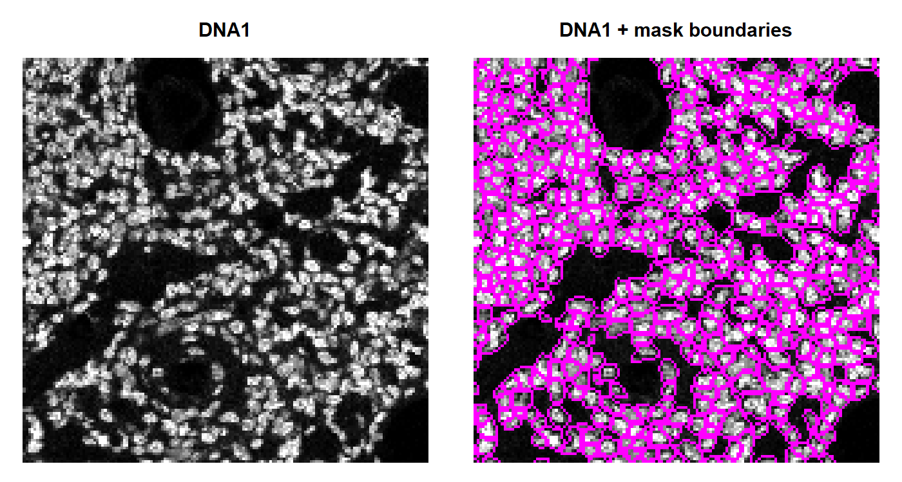
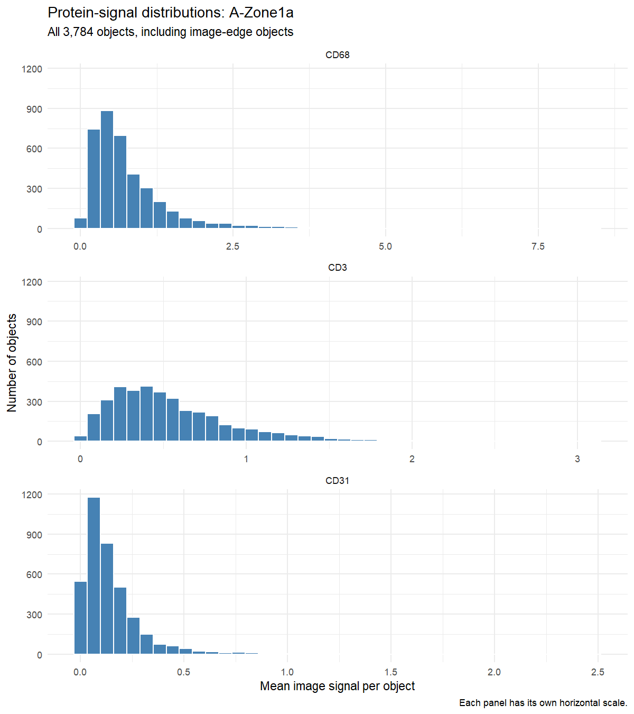
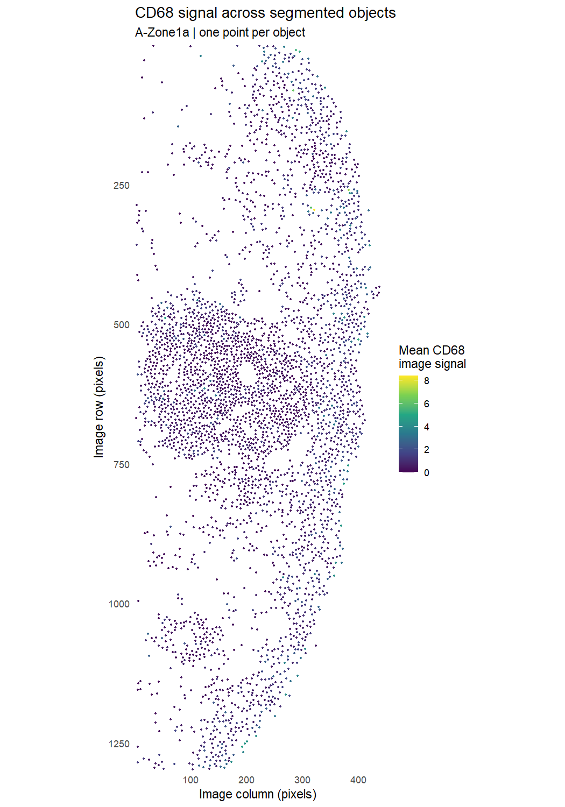
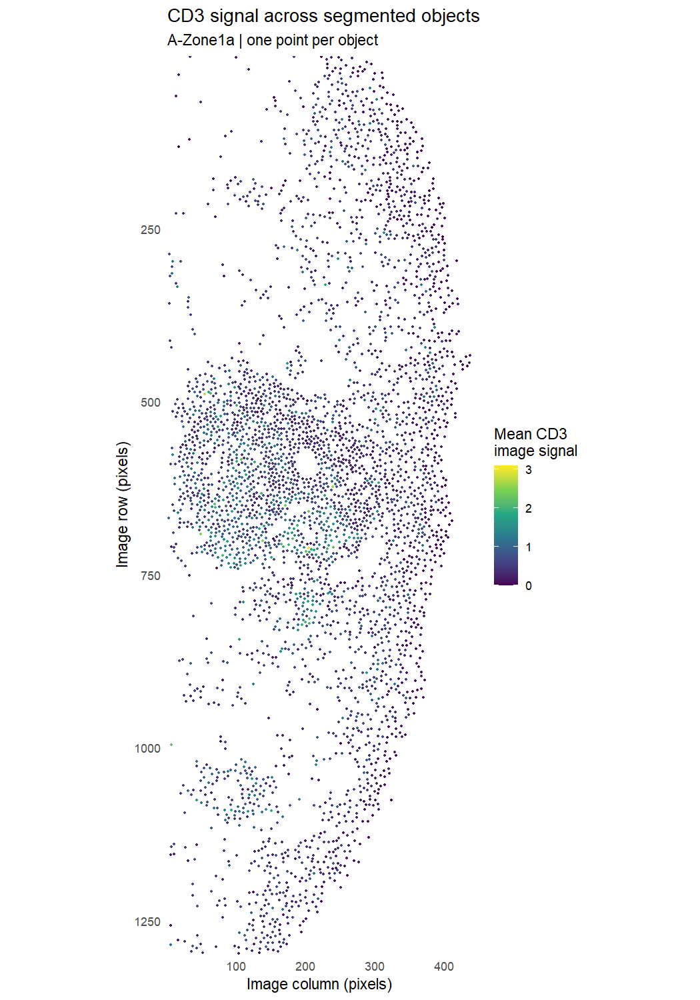
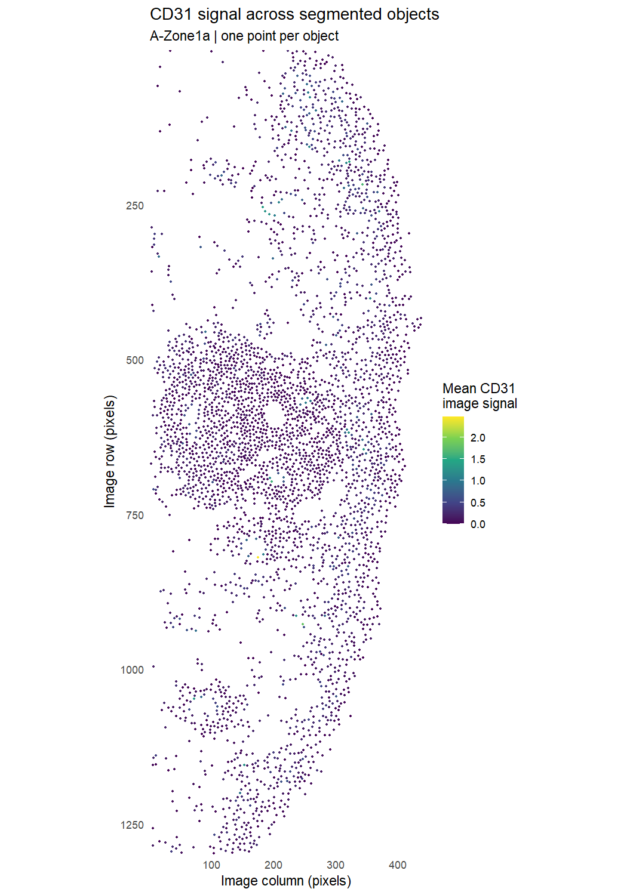
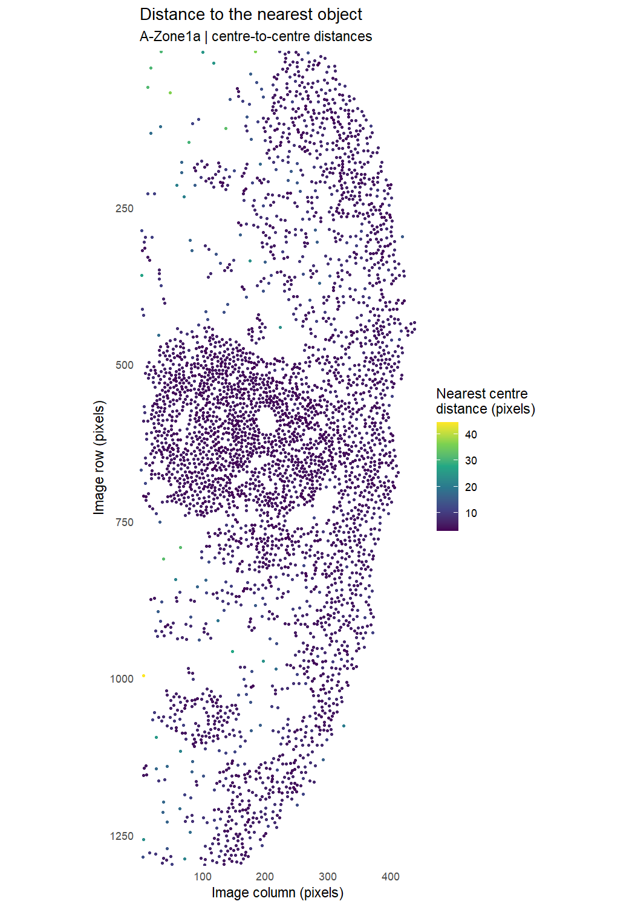

# Exploring spatial protein signals in synovial tissue using R

 A bioinformatics learning project by Seema Sharma.

This project explores one tissue region from a public imaging mass cytometry
(IMC) study of synovial tissue. It is a learning analysis of existing data,
not a claim of new biological discovery.

## Project question

How are CD68, CD3 and CD31 image signals distributed across segmented objects
in one synovial tissue region, and how closely spaced are those objects?

## Data source and scope

- Dataset: [De Lima study IMC images, Zenodo version 2](https://zenodo.org/records/23392665).
- Dataset creator listed on Zenodo: Frédéric Blanchard.
- Associated study: [Spatial mapping of rheumatoid arthritis synovial niches reveals a LYVE1+ macrophage network associated with response to therapy](https://doi.org/10.1016/j.ard.2025.07.019).
- Analysed region: **A-Zone1a**, labelled **Active RA** in the supplied spreadsheet.
- Image dimensions: **1,298 rows × 439 columns**.
- The selected region contains **45 TIFF files**.
- This analysis uses DNA1, CD68, CD3, CD31 and the supplied segmentation mask.
- The original ZIP was verified against its published MD5 checksum:
  `8be86adedb5832645fe20aabe7241012`.

The source study contains multiple regions and conditions. This project
analyses only one region and makes no between-patient or treatment comparisons.

These are rheumatoid arthritis data, not haemophilic arthropathy data.
The methods provide practice relevant to my longer-term interest in
spatial analysis of synovial tissue.

## Workflow

1. Download and verify the public archive.
2. Inspect sample information and extract one tissue region.
3. Check image dimensions and values.
4. Review supplied segmentation boundaries over DNA1.
5. Measure object area, centre coordinates and mean marker signals.
6. Map marker signals and calculate nearest-object distances.
7. Check sensitivity to excluding image-edge objects from summaries.
8. Rerun the analysis and compare the final measurement table.

## Segmentation review

The mask contains **3,784 positive labels**, treated as segmented objects.
A central crop was inspected visually. This does not validate every boundary
or establish that every object represents one complete cell.



## Protein signals

Each measurement is the mean original image value inside a segmented object.
No background correction or calibrated protein-concentration measurement
was performed.



The distributions are right-skewed. No positivity thresholds or cell-type
assignments were made. Marker maps use separate colour scales; equal colours
across maps do not imply equal protein abundance.







## Spatial distances

Nearest-neighbour distances were calculated between object centres within
this region. The median distance was **5.924 pixels**, and the mean was
**6.482 pixels**.



These are straight-line distances in pixels, not cell-boundary distances,
physical distances in micrometres or evidence of biological communication.

## Image-edge sensitivity checks

**25 objects (0.7%)** touched the rectangular image boundary.

| Summary | All objects | Excluding edge-touching objects |
|---|---:|---:|
| Number of objects | 3,784 | 3,759 |
| Mean CD68 signal | 0.7885 | 0.7869 |
| Median CD68 signal | 0.5966 | 0.5962 |
| Mean nearest distance, pixels | 6.482 | 6.446 |
| Median nearest distance, pixels | 5.924 | 5.918 |

These summaries changed little under this exclusion. All objects remained
eligible as neighbours when calculating distances.

This limited check does not fully correct spatial edge effects. Objects near
an image edge may have unobserved neighbours outside the image, even when
their masks do not touch the edge.

## Reproduce the analysis

Open `synovial-spatial-proteomics.Rproj` in RStudio.

In the RStudio Console, run:

```r
source("scripts/22_run_all.R")
```

The runner executes scripts 00–21 in order. Missing packages are installed,
and the original ZIP is downloaded if absent. Internet access is required
for those steps.

An empty-workspace rerun completed successfully, and its final measurement
table matched the previous table within the configured numerical tolerance.

During reruns with existing extracted files, the extraction steps can issue
“not overwriting file” warnings because `overwrite = FALSE` preserves them.

The runner saves:
- `docs/reproducibility_run_log.txt`
- `docs/session_info_rerun.txt`

If a previous final table exists, the runner compares it with the regenerated
table. A first run without that table cannot perform the comparison.

## Folder organisation

| Folder | Contents |
|---|---|
| `scripts` | Numbered analysis scripts and rerun script |
| `data_raw` | Downloaded archive and extracted source files |
| `data_processed` | Derived object-measurement tables |
| `results` | Quality-control and sensitivity summaries |
| `figures` | Saved PNG figures |
| `docs` | Review notes, file inventory and session records |

## Limitations and learning context

- One selected region cannot represent a disease, patient population or treatment response.
- Segmentation was supplied by the original study, not generated here.
- Protein measurements depend on staining, acquisition and segmentation.
- No cell types or blood vessels were identified from these markers alone.
- Spatial patterns were explored descriptively; no spatial enrichment test was performed.
- Larger distances can reflect tissue geometry, missing segmentation or image boundaries.

## Possible next steps

Review additional regions, verify physical pixel dimensions, evaluate
segmentation more extensively and learn validated multi-marker annotation
before attempting cell-type-specific spatial comparisons.